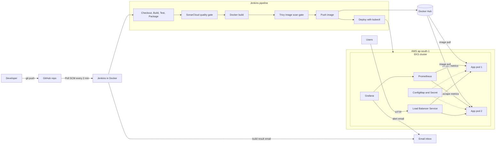

# FinSecure Pay: Transaction Validator

A Spring Boot transaction validation API with a complete DevOps pipeline: Git, Maven, JUnit 5, Docker, Jenkins, SonarCloud, Trivy, Kubernetes on AWS EKS, Prometheus and Grafana.

FinSecure Pay is a fictional fintech startup that needs a fast, repeatable and reliable way to deploy a transaction validation API with minimal manual work. A `git push` starts a pipeline that tests, scans, builds and deploys the application, and the running system is monitored with dashboards and email alerts.

> No passwords, tokens or keys are stored in this repository. Credentials live in Jenkins credentials and Kubernetes Secrets. Placeholders such as `<your-...>` must be replaced with your own values.

## Architecture



## Repository layout

```
capstone/
├── Jenkinsfile                  # CI/CD pipeline definition
├── Dockerfile                   # multi-stage image build
├── .dockerignore
├── pom.xml                      # Maven build and dependencies
├── mvnw, mvnw.cmd, .mvn/        # Maven Wrapper
├── src/
│   ├── main/java/com/finsecure/transaction_validator/
│   │   ├── controller/          # /health and /validate endpoints
│   │   ├── model/               # request and result records
│   │   └── service/             # validation rules
│   ├── main/resources/application.properties
│   └── test/java/...            # JUnit 5 tests (14)
├── k8s/
│   ├── configmap.yaml           # configurable settings
│   ├── deployment.yaml          # 2 replicas, probes, rolling update
│   ├── service.yaml             # LoadBalancer Service
│   └── eks-cluster.yaml         # eksctl cluster definition (not a Kubernetes manifest)
└── monitoring/
    ├── values.yaml              # Helm values for Prometheus and Grafana
    ├── servicemonitor.yaml      # tells Prometheus to scrape the app
    └── dashboard.json           # Grafana dashboard
```

## Prerequisites

| Tool | Used for |
|---|---|
| Java 21 and Git | Build and source control |
| Docker | Containers, and running Jenkins |
| `kubectl` | Talking to the cluster |
| `eksctl` and AWS CLI v2 | Creating and reaching the EKS cluster |
| Helm | Installing Prometheus and Grafana |
| Accounts | GitHub, Docker Hub, SonarCloud, an AWS account you are allowed to use, a Gmail account (for alert and build emails) |

## 1. Run the application locally

```bash
git clone https://github.com/aswinvijayan04/capstone.git
cd capstone

./mvnw -B test              # 14 JUnit 5 tests
./mvnw spring-boot:run      # starts on http://localhost:8080

curl -i http://localhost:8080/health

curl -i -X POST http://localhost:8080/validate \
  -H "Content-Type: application/json" \
  -d '{"transactionId":"TXN-1001","accountId":"ACC-42","amount":2500.50,"currency":"INR"}'
```

`GET /health` returns `{"status":"UP","service":"transaction-validator"}`.

`POST /validate` returns HTTP 200 with `{"valid":true,"errors":[]}` for a valid transaction, or HTTP 400 with `{"valid":false,"errors":[...]}`. The rules are:

| Field | Rule |
|---|---|
| `transactionId` | Required, not blank |
| `accountId` | Required, not blank |
| `amount` | Required, greater than 0, not above 100000 |
| `currency` | One of INR, USD, EUR (not case sensitive) |

Prometheus metrics are exposed at `/actuator/prometheus`.

## 2. Run in Docker

```bash
docker build -t transaction-validator:1.0.0 .

# Two containers from one image on different host ports
docker run -d --name tv-1 -p 8080:8080 transaction-validator:1.0.0
docker run -d --name tv-2 -p 8081:8080 transaction-validator:1.0.0
curl -i http://localhost:8080/health
curl -i http://localhost:8081/health

# Tag and push (log in with a Docker Hub access token, not your password)
docker login -u <your-dockerhub-username>
docker tag transaction-validator:1.0.0 <your-dockerhub-username>/transaction-validator:1.0.0
docker push <your-dockerhub-username>/transaction-validator:1.0.0

docker stop tv-1 tv-2 && docker rm tv-1 tv-2
```

The Dockerfile is multi-stage: the first stage builds the jar with Maven and the JDK, and the final stage is a JRE-only Alpine image that runs as a non-root user.

Published image: `aswinvijayan04/transaction-validator`

## 3. Deploy to AWS EKS

```bash
aws configure                         # region: ap-south-1
eksctl create cluster -f k8s/eks-cluster.yaml     # about 20 minutes
kubectl get nodes                     # expect 2 nodes in Ready state

# Apply the three manifests by name (eks-cluster.yaml is an eksctl file, not a Kubernetes manifest)
kubectl apply -f k8s/configmap.yaml -f k8s/deployment.yaml -f k8s/service.yaml
kubectl get pods -o wide              # expect 2 pods 1/1 Running

# External access through the AWS load balancer (it can take 2 to 3 minutes to appear)
LB=$(kubectl get svc transaction-validator -o jsonpath='{.status.loadBalancer.ingress[0].hostname}')
curl -i http://$LB/health
```

**Self-healing test:** delete a pod and watch Kubernetes recreate it.

```bash
kubectl get pods -w                   # terminal 1
kubectl delete pod <one-pod-name>     # terminal 2
```

**Kubernetes Secret example** (the value is generated and never printed):

```bash
kubectl create secret generic transaction-validator-secret \
  --from-literal=PAYMENT_API_KEY="$(openssl rand -hex 16)"
kubectl set env deployment/transaction-validator --from=secret/transaction-validator-secret
```

**Note on node types:** if the AWS account is on a Free Tier plan, only some instance types are allowed. This project uses `m7i-flex.large`. If node creation fails, check `aws autoscaling describe-scaling-activities --region ap-south-1` for the reason.

## 4. Jenkins CI/CD

### Start Jenkins

```bash
docker volume create jenkins_home

docker run -d --name jenkins \
  -p 8085:8080 -p 50000:50000 \
  -v jenkins_home:/var/jenkins_home \
  -v /var/run/docker.sock:/var/run/docker.sock \
  --group-add $(getent group docker | cut -d: -f3) \
  jenkins/jenkins:lts-jdk21

docker update --restart unless-stopped jenkins     # optional: restart after a reboot
docker exec jenkins cat /var/jenkins_home/secrets/initialAdminPassword
```

Open http://localhost:8085, enter the password, choose **Install suggested plugins** and create an admin user.

### Install the Docker CLI, AWS CLI and kubectl inside Jenkins

```bash
docker exec -u root jenkins bash -c '
  curl -fsSL https://download.docker.com/linux/static/stable/x86_64/docker-27.3.1.tgz \
  | tar xz --strip-components=1 -C /usr/local/bin docker/docker
'

docker exec -u root jenkins bash -c '
  apt-get update -qq && apt-get install -y -qq unzip curl &&
  cd /tmp &&
  curl -fsSL https://awscli.amazonaws.com/awscli-exe-linux-x86_64.zip -o awscliv2.zip &&
  unzip -q awscliv2.zip && ./aws/install &&
  curl -fsSLo /usr/local/bin/kubectl "https://dl.k8s.io/release/$(curl -fsSL https://dl.k8s.io/release/stable.txt)/bin/linux/amd64/kubectl" &&
  chmod +x /usr/local/bin/kubectl
'

docker exec jenkins docker ps
docker exec jenkins aws --version
docker exec jenkins kubectl version --client
```

### Credentials

Add these under **Manage Jenkins → Credentials → System → Global credentials**. The IDs must match the Jenkinsfile.

| ID | Kind | Contents |
|---|---|---|
| `dockerhub-creds` | Username with password | Docker Hub username and an access token (Read and Write) |
| `sonar-token` | Secret text | SonarCloud token |
| `aws-creds` | Username with password | AWS access key ID as username, secret access key as password |
| `gmail-smtp` | Username with password | Gmail address and a Gmail app password |

### Email settings

Under **Manage Jenkins → System**: set the **System Admin e-mail address** to your Gmail address. In **Extended E-mail Notification** set SMTP server `smtp.gmail.com`, port `465`, tick **Use SSL**, choose the `gmail-smtp` credential, and set **Default Recipients** to the address that should receive build emails.

### Create the pipeline job

1. **New Item**, name `finsecure-pipeline`, type **Pipeline**.
2. Pipeline definition: **Pipeline script from SCM**, SCM **Git**.
3. Repository URL `https://github.com/aswinvijayan04/capstone.git`, branch `*/main`, script path `Jenkinsfile`.
4. Save, then **Build Now** once. The `pollSCM` trigger in the Jenkinsfile then checks GitHub about every 2 minutes.
5. In the Jenkinsfile, set `SONAR_ORG` and `SONAR_PROJECT` in the `environment` block to your SonarCloud organization key and project key.

### Pipeline stages

| Stage | What it does |
|---|---|
| Checkout | Gets the code from GitHub |
| Build | `./mvnw clean compile` |
| Test | `./mvnw test`, publishes JUnit results; a failing test stops the pipeline |
| Package | Builds the jar and archives it |
| Security Checks | SonarCloud analysis, waits for the quality gate |
| Container Build | Builds the image, tagged `1.0.<build number>` |
| Security Scan | Trivy scans the image; any HIGH or CRITICAL finding fails the build |
| Push | Pushes the image to Docker Hub |
| Deploy | `aws eks update-kubeconfig`, `kubectl set image`, then waits for `rollout status` |

On success or failure, Jenkins sends an email with the build result. The Deploy stage needs a running cluster named `finsecure-cluster` in `ap-south-1`.

## 5. Security checks

- **SonarCloud:** import the repository, turn **Automatic Analysis** off (CI-based analysis conflicts with it), note the organization and project key, and create a token for Jenkins.
- **Trivy image scan** (run by hand to see the same result as the pipeline):

  ```bash
  docker run --rm -v /var/run/docker.sock:/var/run/docker.sock -v trivy-cache:/root/.cache/ \
    aquasec/trivy:latest image --scanners vuln --severity HIGH,CRITICAL \
    <your-dockerhub-username>/transaction-validator:1.0.0
  ```

  Check that the report lists real targets (for example `alpine` and `app/app.jar`). A report of `-` means nothing was scanned.
- **Security gate demonstration:** a deliberately vulnerable library (`commons-text` 1.9, CVE-2022-42889) was added, the Security Scan stage failed and no image was pushed. Upgrading to 1.10.0 let the same pipeline pass.
- **Secrets:** never commit credentials. Use Jenkins credentials and Kubernetes Secrets. Kubernetes Secrets are only base64-encoded, so restrict access with RBAC, and consider AWS Secrets Manager or Vault for production.

## 6. Monitoring, alerting and logging

### Install Prometheus and Grafana

```bash
helm repo add prometheus-community https://prometheus-community.github.io/helm-charts
helm repo update
kubectl create namespace monitoring

# The values file refers to this Secret, so create it BEFORE installing.
# read -s hides the password while you type it.
read -s -p "Gmail app password: " SMTP_PASS; echo
kubectl create secret generic grafana-smtp -n monitoring \
  --from-literal=GF_SMTP_USER="<your-gmail-address>" \
  --from-literal=GF_SMTP_FROM_ADDRESS="<your-gmail-address>" \
  --from-literal=GF_SMTP_PASSWORD="$SMTP_PASS"
unset SMTP_PASS

helm install monitoring prometheus-community/kube-prometheus-stack \
  --namespace monitoring \
  -f monitoring/values.yaml \
  --set grafana.adminPassword="$(openssl rand -hex 8)"

kubectl get pods -n monitoring -w                 # wait until all pods are Running
kubectl apply -f monitoring/servicemonitor.yaml   # tell Prometheus to scrape the app
```

### Open Grafana

```bash
# Read the admin password (do not screenshot it)
kubectl get secret monitoring-grafana -n monitoring -o jsonpath="{.data.admin-password}" | base64 -d; echo

kubectl port-forward -n monitoring svc/monitoring-grafana 3000:80       # http://localhost:3000, user: admin
kubectl port-forward -n monitoring svc/monitoring-kube-prometheus-prometheus 9090:9090   # optional: Prometheus UI
```

Import `monitoring/dashboard.json` (**Dashboards → New → Import**). It shows available pods, request rate, JVM heap memory, node CPU and pod restarts.

### Alert and notification

1. **Alerting → Contact points → Add contact point:** name `email-alerts`, integration **Email**, your address, then **Test**.
2. **Alerting → Notification policies:** set the default contact point to `email-alerts`.
3. **Alerting → Alert rules → New alert rule:** name `App pods below 2`, query  
   `kube_deployment_status_replicas_available{namespace="default", deployment="transaction-validator"}`,  
   condition **IS BELOW 2**, evaluation group every 1m with a 1m pending period, label `severity=critical`.
4. **Trigger it:** `kubectl scale deployment transaction-validator --replicas=1`, wait about 3 minutes for **Firing** and the email, then restore with `--replicas=2`.

Grafana does not keep its data when the cluster is deleted, so repeat these steps on a new cluster.

### Logs and troubleshooting

```bash
kubectl logs deploy/transaction-validator --tail=20            # one pod
kubectl logs -l app=transaction-validator --tail=5 --prefix    # all pods, labelled
kubectl logs -f deploy/transaction-validator                   # follow live
kubectl logs deploy/transaction-validator --previous           # after a crash
kubectl describe pod -l app=transaction-validator              # events, probe failures
kubectl get events --sort-by=.lastTimestamp | tail -15
```

## 7. Rollout and rollback

```bash
# New version (the Jenkins Deploy stage does this for you)
kubectl set image deployment/transaction-validator transaction-validator=<your-dockerhub-username>/transaction-validator:<tag>
kubectl rollout status deployment/transaction-validator
kubectl rollout history deployment/transaction-validator

# Roll back to the previous version
kubectl rollout undo deployment/transaction-validator
kubectl describe deployment transaction-validator | grep Image
```

After a rollback, run `git revert` on the change so that Git and the cluster agree.

## 8. Clean up (important: the cluster costs money)

```bash
kubectl delete svc transaction-validator        # lets AWS remove the load balancer cleanly
eksctl delete cluster -f k8s/eks-cluster.yaml   # takes 15 to 20 minutes

# Check that nothing is left
aws eks list-clusters --region ap-south-1
aws ec2 describe-instances --region ap-south-1 --filters "Name=instance-state-name,Values=pending,running" --query 'Reservations[].Instances[].InstanceId'
aws elbv2 describe-load-balancers --region ap-south-1 --query 'LoadBalancers[].LoadBalancerName'
aws elb describe-load-balancers --region ap-south-1 --query 'LoadBalancerDescriptions[].LoadBalancerName'
aws ec2 describe-volumes --region ap-south-1 --query 'Volumes[].VolumeId'
```

The cluster can stay listed for 5 to 10 minutes after `eksctl` finishes, because the control plane deletes in the background. When the project is finished, delete the IAM user and revoke the tokens you created (GitHub, Docker Hub, SonarCloud, Gmail app passwords).

## 9. Troubleshooting

| Problem | Likely cause and fix |
|---|---|
| Node group never starts | The AWS plan does not allow the instance type. Check the scaling-activity log and choose an allowed type. |
| `ImagePullBackOff` | The image tag does not exist or the Docker Hub repository is private. |
| Jenkins build does not start | Jenkins is stopped (`docker start jenkins`), or polling is not registered; click **Build Now**. |
| Maven Central returns 429 | Rate limit. Wait 30 minutes and reuse cached dependencies. |
| Docker Hub download times out | Pull the base image first with `docker pull`, then rebuild. |
| Trivy report shows `-` | Nothing was scanned. Use `image` or `rootfs` mode, not `fs`, on a jar. |
| `kubectl apply -f k8s/` fails | The folder contains the eksctl file. Apply the three manifests by name. |
| Grafana does not load | Restart the port-forward command. |
| Jenkins push gets a 403 from GitHub | Git is using another account's saved login. Use a token for the right account. |

## 10. Core test cases

| Test case | Expected result |
|---|---|
| Run unit tests | 14 tests pass |
| Controlled failing test | Pipeline fails at Test; deployment does not proceed |
| Run the container and call `/health` | Healthy response |
| Inspect the Kubernetes deployment | 2 pods running and Ready |
| Deploy a new image version | Rollout completes successfully |
| Delete a pod | Kubernetes recreates it automatically |
| Controlled critical finding | The security gate blocks the release |
| Trigger a monitoring condition | Alert fires and an email is received |

## Links

- GitHub: https://github.com/aswinvijayan04/capstone
- Docker Hub: https://hub.docker.com/r/aswinvijayan04/transaction-validator